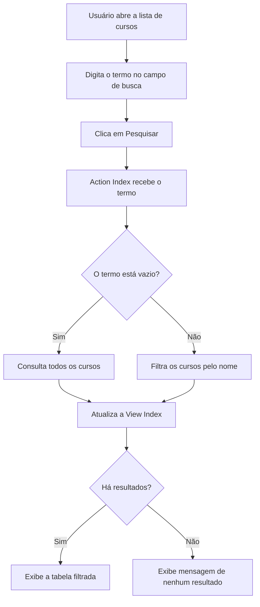

# 🚀 Guia Prático: Construindo o Sistema de Escolha de Cursos Universitários em ASP.NET Core MVC (.NET 9)

## 📌 Contextualização e Objetivo
No desenvolvimento de software corporativo e acadêmico, é muito comum recebermos um problema de negócio e precisarmos **modelar o banco de dados do zero** antes de iniciar a codificação da aplicação. 

Nesta atividade prática, você atuará como **Desenvolvedor Full-Stack**, passando por todas as etapas do ciclo de desenvolvimento:
1. **Modelagem de Dados (DER):** Interpretar o cenário de negócio, desenhar o Diagrama Entidade-Relacionamento e criar as tabelas no **SQL Server**.
2. **Engenharia Reversa (Database First):** Importar a estrutura do banco criado para o **ASP.NET Core MVC (.NET 9)** utilizando o **Entity Framework Core**.
3. **CRUD e Controle de Acesso:** Gerar as telas automaticamente (*Scaffolding*) e implementar uma tela de **Login** validando os usuários cadastrados no banco de dados.
4. **Busca de Cursos:** Implementar um formulário de pesquisa para filtrar os cursos cadastrados pelo nome, usando ASP.NET Core MVC, LINQ e Entity Framework Core.

---

## 🏢 O Cenário de Negócio: Sistema de Escolha de Cursos Universitários
Uma instituição de ensino superior está abrindo seu processo seletivo interno e precisa de um sistema web para gerenciar a inscrição dos estudantes nos cursos disponíveis.

### 📋 Regras de Negócio e Entidades
Analise atentamente o cenário abaixo para modelar seu banco de dados (`dbCursosUniversitarios`):

1. **Cadastro de Alunos (`Aluno`):** 
   - O sistema deve permitir o cadastro dos estudantes interessados (Ex: Código/Id, Nome Completo, CPF ou Matrícula, E-mail, Telefone).
2. **Cadastro de Cursos (`Curso`):** 
   - A universidade oferece diversas opções de graduação (Ex: Código/Id, Nome do Curso, Turno, Carga Horária, Vagas Disponíveis).
   - A listagem dos cursos deverá ter um **campo de busca por nome**, com confirmação pelo botão **Pesquisar**. Após a pesquisa, deverão aparecer somente os registros correspondentes. Uma busca em branco deverá retornar todos os cursos.
3. **Escolha de Cursos (`EscolhaCurso`):** 
   - Cada aluno cadastrado pode escolher **até 3 cursos** diferentes (Ex: 1ª Opção, 2ª Opção e 3ª Opção, ou registros vinculados indicando a ordem de preferência e a data da escolha).
   - *Atenção:* Esta é a tabela associativa/transacional que conecta o **Aluno** aos **Cursos** escolhidos.
4. **Controle de Acesso (`Usuario`):** 
   - O sistema não pode ser acessado por qualquer pessoa. Deve existir uma tabela independente para armazenar os operadores do sistema (Ex: Id, Nome, Login/Email, Senha, Perfil). Apenas usuários cadastrados nesta tabela poderão efetuar login e acessar os cadastros.

---

## 🛠️ Pré-requisitos
- Visual Studio 2022 (com suporte ao .NET 9 instalado)
- Microsoft SQL Server e SQL Server Management Studio (SSMS)
- Ferramenta de modelagem de dados (brModelo, Draw.io, MySQL Workbench ou o próprio Diagrama do SSMS)

---

## 🗄️ Etapa 1: Modelagem (DER) e Criação do Banco de Dados no SQL Server
Diferente de tutoriais onde o script já vem pronto, **aqui você é o arquiteto do banco!**

1. **Desenhe o DER (Diagrama Entidade-Relacionamento):**
   - Represente as **3 tabelas de negócio** (`Aluno`, `Curso` e `EscolhaCurso`) com suas respectivas Chaves Primárias (`PK`) e Chaves Estrangeiras (`FK`), garantindo a cardinalidade correta para que um aluno possa escolher até 3 cursos.
   - Represente a **1 tabela de segurança/acesso** (`Usuario`).
2. **Crie o Banco no SQL Server:**
   - Abra o **SSMS**, crie o banco de dados `dbCursosUniversitarios`.
   - Escreva e execute os comandos DDL (`CREATE TABLE`) criando as 4 tabelas, definindo tipos de dados adequados (`INT`, `VARCHAR`, `DATETIME`, etc.) e aplicando as devidas `CONSTRAINTS` (`PRIMARY KEY`, `FOREIGN KEY`, `UNIQUE` para CPF/Login).
3. **Popule o Banco para Testes (`INSERT`):**
   - Insira pelo menos **2 usuários** na tabela `Usuario` (para testar o login).
   - Insira pelo menos **5 cursos** universitários na tabela `Curso` (ex: Ciência da Computação, Engenharia de Software, Direito, Administração, Enfermagem).
   - Insira pelo menos **2 alunos** na tabela `Aluno`.

---

## 📁 Etapa 2: Criação do Projeto no Visual Studio
1. Abra o **Visual Studio 2022**.
2. Clique em **Criar um novo projeto**.
3. Selecione o modelo **Aplicativo Web do ASP.NET Core (Model-View-Controller)** e clique em **Próximo**.
4. Defina o nome da solução como `AppCursosUniversitarios` e clique em **Próximo**.
5. Selecione o Framework **.NET 9.0 (Suporte de Termo Padrão)** e clique em **Criar**.

---

## 📦 Etapa 3: Instalação dos Pacotes do Entity Framework
Abra o **Gerenciador de Pacotes NuGet** (ou o Console do Gerenciador de Pacotes) e instale os seguintes pacotes na versão compatível com o .NET 9:

- `Microsoft.EntityFrameworkCore.SqlServer`
- `Microsoft.EntityFrameworkCore.Tools`
- `Microsoft.VisualStudio.Web.CodeGeneration.Design`

---

## ⚙️ Etapa 4: Configuração da String de Conexão no `appsettings.json`
Abra o arquivo `appsettings.json` na raiz do projeto e configure a propriedade `ConnectionStrings` apontando para o banco que você criou na Etapa 1.

```json
{
  "Logging": {
    "LogLevel": {
      "Default": "Information",
      "Microsoft.AspNetCore": "Warning"
    }
  },
  "AllowedHosts": "*",
  "ConnectionStrings": {
    "ConexaoSqlServer": "Server=localhost; Database=dbCursosUniversitarios; Trusted_Connection=True; TrustServerCertificate=True;"
  }
}
```
*(Nota: Caso utilize autenticação via usuário/senha do SQL Server, ajuste a string com `User Id=...; Password=...;` conforme o ambiente do laboratório).*

---

## 🔨 Etapa 5: Engenharia Reversa (Scaffolding do Banco)
Agora vamos importar as 4 tabelas que você modelou no SQL Server para dentro da pasta `Models` do projeto.

Abra o **Console do Gerenciador de Pacotes** (*Ferramentas > Gerenciador de Pacotes NuGet > Console do Gerenciador de Pacotes*) e execute:

```powershell
Scaffold-DbContext "Name=ConexaoSqlServer" Microsoft.EntityFrameworkCore.SqlServer -OutputDir Models -Force
```
Verifique se na pasta `Models` foram geradas as classes `Aluno.cs`, `Curso.cs`, `EscolhaCurso.cs`, `Usuario.cs` e o arquivo de contexto `DbCursosUniversitariosContext.cs`.

---

## 🔨 Etapa 6: Compilação Obrigatória da Solução
Antes de gerar as telas e controllers, o projeto precisa estar limpo e compilado:
- Pressione `Ctrl + Shift + B` ou clique com o botão direito na Solução e selecione **Recompilar (Rebuild)**.

---

## 🔌 Etapa 7: Registro do DbContext na Injeção de Dependência (`Program.cs`)
Abra o arquivo `Program.cs` e registre o contexto do banco de dados antes da linha `var app = builder.Build();`:

```csharp
using Microsoft.EntityFrameworkCore;
using AppCursosUniversitarios.Models;

var builder = WebApplication.CreateBuilder(args);

// Adicionar os serviços ao contêiner
builder.Services.AddControllersWithViews();

// Registrando o DbContext com a String de Conexão
builder.Services.AddDbContext<DbCursosUniversitariosContext>(options =>
    options.UseSqlServer(builder.Configuration.GetConnectionString("ConexaoSqlServer")));

var app = builder.Build();
```

---

## 🎨 Etapa 8: Gerando o CRUD Automático (Scaffolding MVC)
Vamos criar os **Controllers** e **Views Razor** para as entidades do sistema:

1. No **Gerenciador de Soluções**, clique com o botão direito na pasta `Controllers` > **Adicionar** > **Novo Item com Scaffolding...**.
2. Selecione **Controlador MVC com exibições, usando o Entity Framework** e clique em **Adicionar**.
3. Na janela de configuração:
   - **Classe de modelo:** Selecione `Aluno (AppCursosUniversitarios.Models)`.
   - **Classe do contexto de dados:** Selecione `DbCursosUniversitariosContext (AppCursosUniversitarios.Models)`.
   - **Exibições:** Mantenha marcada a opção de gerar views.
4. Clique em **Adicionar**.
5. **Repita o mesmo procedimento** para as classes de modelo:
   - `Curso`
   - `EscolhaCurso`
   - `Usuario`

---

## 🔐 Etapa 9: Implementando o Controle de Acesso (Login)
Para garantir que apenas usuários cadastrados na tabela `Usuario` acessem o sistema:

1. Crie um `LoginController.cs` com uma View `Index.cshtml` contendo um formulário simples de **Login** e **Senha**.
2. Na Action `[HttpPost]`, consulte o `_context.Usuarios` verificando se existe um registro com o login e senha informados.
   - **Se válido:** Salve a informação do usuário na Sessão (`HttpContext.Session`) ou utilize Cookies de Autenticação e redirecione para `Home/Index`.
   - **Se inválido:** Exiba uma mensagem de erro (`ViewBag.Erro = "Usuário ou senha inválidos."`) na tela de login.
3. Configure a rota padrão no `Program.cs` para abrir primeiramente a tela de `Login` e proteja os Controllers (`Aluno`, `Curso`, `EscolhaCurso`, `Usuario`) para redirecionar ao Login caso não haja usuário autenticado.

---

## 🔎 Etapa 10: Implementando a Busca de Cursos (ASP.NET Core MVC)

### 🎯 Situação-problema
A instituição oferece diversos cursos e os operadores precisam encontrar rapidamente uma formação específica. Atualmente, a página de listagem apresenta todos os registros, exigindo uma procura manual.

**Sua tarefa:** adicionar à listagem de `Curso` um campo para digitar o nome completo ou parte do nome de uma formação. Ao clicar em **Pesquisar**, o sistema deverá consultar o **SQL Server** e atualizar a tabela com os cursos correspondentes ao termo informado. A pesquisa deve acontecer **na própria página**, sem criar uma segunda listagem.

### 📋 Requisitos funcionais da busca

- **RF01 — Campo de pesquisa:** disponibilizar um campo de texto na página `Views/Cursos/Index.cshtml`.
- **RF02 — Confirmação:** executar a pesquisa quando o usuário clicar em **Pesquisar** ou pressionar **Enter** no formulário.
- **RF03 — Correspondência parcial:** localizar cursos cujo nome contenha o termo informado, inclusive no meio do nome (por exemplo, `Engenharia`).
- **RF04 — Atualização da listagem:** exibir somente os registros encontrados, preservando as colunas e as ações do CRUD.
- **RF05 — Nenhum resultado:** apresentar a mensagem **"Nenhum curso encontrado para o termo informado."**.
- **RF06 — Busca vazia:** ao pesquisar com o campo em branco, exibir todos os cursos cadastrados.
- **RF07 — Limpeza:** incluir a opção **Limpar pesquisa** para voltar à listagem completa.
- **RF08 — Persistência do termo:** manter o texto pesquisado no campo após o envio do formulário.

> **Atenção:** esta etapa amplia o CRUD já desenvolvido. Não é necessário criar uma nova tabela no banco de dados. A busca utiliza a tabela `Curso` existente.

### 🧭 Passo 1: Identificar o Controller e a View

No **Gerenciador de Soluções**, localize:

```text
AppCursosUniversitarios/
├── Controllers/
│   └── CursosController.cs
├── Models/
│   ├── Curso.cs
│   └── DbCursosUniversitariosContext.cs
└── Views/
    └── Cursos/
        └── Index.cshtml
```

O Scaffolding costuma gerar o controller no plural (`CursosController`) e a pasta `Views/Cursos`. **Confira os nomes reais do seu projeto** antes de alterar arquivos. No exemplo a seguir, a entidade possui a propriedade `NomeCurso`. Se, no banco criado por sua equipe, a coluna foi nomeada `Nome`, use a propriedade correspondente gerada na classe `Curso.cs`.

### ⚙️ Passo 2: Modificar a Action `Index` no `CursosController.cs`

Localize o método `Index` que foi gerado automaticamente. Substitua **somente esse método**, preservando os demais métodos de cadastro, edição, detalhes e exclusão.

```csharp
using Microsoft.AspNetCore.Mvc;
using Microsoft.EntityFrameworkCore;
// Os demais 'using' e a classe gerada pelo Scaffolding permanecem.

public async Task<IActionResult> Index(string? termo)
{
    // O texto informado será utilizado também na View.
    ViewData["TermoBusca"] = termo;

    // IQueryable: a filtragem será montada antes da consulta ao banco.
    var consulta = _context.Cursos.AsNoTracking().AsQueryable();

    if (!string.IsNullOrWhiteSpace(termo))
    {
        string texto = termo.Trim();

        // Busca por parte do nome do curso.
        consulta = consulta.Where(c => c.NomeCurso.Contains(texto));
    }

    // Executa a consulta filtrada no SQL Server.
    var cursos = await consulta.ToListAsync();
    return View(cursos);
}
```

**Entenda o código:**

1. `string? termo` recebe o valor enviado pelo formulário de pesquisa.
2. `ViewData["TermoBusca"]` permite apresentar novamente o texto digitado.
3. `_context.Cursos` representa os cursos cadastrados no banco de dados.
4. `Where(...)` adiciona a condição de busca à consulta, enquanto `Contains(texto)` procura o trecho informado.
5. `ToListAsync()` executa a consulta e devolve à View somente os registros encontrados.

**Observação:** a distinção entre letras maiúsculas e minúsculas depende da *collation* configurada no SQL Server. Para esta atividade, utilize a configuração do banco do laboratório e verifique esse comportamento nos testes. Não carregue todos os dados em memória para depois filtrar com `ToList().Where(...)`.

### 🖥️ Passo 3: Criar o formulário na View `Index.cshtml`

Abra `Views/Cursos/Index.cshtml`. Mantenha o `@model` e a tabela existentes. **Acrescente o bloco abaixo acima da tabela de cursos:**

```cshtml
<form asp-controller="Cursos" asp-action="Index" method="get"
      class="mb-3">
    <div class="input-group">
        <input type="text"
               name="termo"
               value="@ViewData["TermoBusca"]"
               class="form-control"
               placeholder="Digite o nome do curso"
               aria-label="Pesquisar curso pelo nome" />

        <button type="submit" class="btn btn-primary">
            Pesquisar
        </button>

        <a asp-controller="Cursos" asp-action="Index"
           class="btn btn-outline-secondary">
            Limpar pesquisa
        </a>
    </div>
</form>
```

O atributo `name="termo"` deve corresponder exatamente ao parâmetro `termo` da Action `Index`. O método HTTP **GET** torna o termo pesquisado visível na URL, como em `/Cursos?termo=Direito`. Não use o formulário de pesquisa para enviar dados sensíveis.

### 📋 Passo 4: Mostrar uma mensagem quando não houver resultados

Ainda na View `Index.cshtml`, localize o `<tbody>` da tabela gerada pelo Scaffolding. Envolva o `foreach` existente com a verificação a seguir:

```cshtml
<tbody>
@if (!Model.Any())
{
    <tr>
        <td colspan="6" class="text-center text-muted">
            Nenhum curso encontrado para o termo informado.
        </td>
    </tr>
}
else
{
    // Mantenha aqui o foreach original gerado pelo Scaffolding,
    // com as células e os links Edit, Details e Delete.
    foreach (var item in Model)
    {
        <tr>
            <!-- Reaproveite aqui as células originais da sua tabela. -->
        </tr>
    }
}
</tbody>
```

**Importante:** o exemplo acima é um **modelo de integração**, não uma substituição literal do corpo da tabela. Você deve **manter as células que já exibem os campos de Curso e os botões do CRUD** dentro do `foreach`. Altere o número `6` em `colspan` para corresponder à quantidade real de colunas da tabela, incluindo a coluna de ações. Não deixe o `<tr>` demonstrativo vazio no código final.

### 🧪 Passo 5: Testar a funcionalidade

Antes dos testes, confira se o banco possui pelo menos os cinco cursos sugeridos na Etapa 1. Execute a aplicação, faça login e abra **Cursos**.

| Teste | Ação do usuário | Resultado esperado |
|---|---|---|
| 01 — Lista completa | Acessar `Cursos/Index` sem termo | Todos os cursos cadastrados são exibidos. |
| 02 — Nome completo | Pesquisar `Direito` | Exibir o curso Direito, se cadastrado. |
| 03 — Parte do nome | Pesquisar `Engenharia` | Exibir cursos com `Engenharia` no nome. |
| 04 — Sem correspondências | Pesquisar `Curso Inexistente 123` | Exibir a mensagem de nenhum resultado, sem erro de execução. |
| 05 — Campo vazio | Apagar o termo e clicar em **Pesquisar** | Voltar a mostrar todos os cursos. |
| 06 — Limpar | Realizar uma pesquisa e clicar em **Limpar pesquisa** | Remover o filtro e restaurar a lista. |
| 07 — CRUD preservado | Abrir **Editar** de um curso encontrado | A tela de edição continua funcionando. |
| 08 — Acesso | Abrir a página sem autenticação | O sistema aplica a proteção de acesso implementada na Etapa 9. |

### 🧠 Para compreender o funcionamento



### 🔐 Atenção à segurança e à qualidade do projeto

A página de busca deverá estar protegida pelo mecanismo de autenticação já desenvolvido. Para um sistema real, **não armazene senhas em texto simples nem compare senhas diretamente com os valores do banco**: use hashes de senha e um mecanismo de autenticação apropriado, preferencialmente o ASP.NET Core Identity. Evite publicar dados reais de alunos, logins, senhas ou credenciais de conexão no GitHub. Ao usar configuração local, proteja as credenciais com mecanismos adequados ao ambiente, como *User Secrets*.

---

## 🎯 Resultado Esperado e Entregáveis
Ao finalizar a atividade, você deverá entregar:
1. **Arquivo de Imagem ou PDF do DER** modelado na Etapa 1.
2. **Script SQL (`.sql`)** contendo a criação do banco, tabelas, constraints e `INSERTs` iniciais.
3. **Projeto ASP.NET Core MVC completo** contendo:
   - Tela de Login funcional validando na tabela `Usuario`.
   - CRUD completo para `Aluno`, `Curso`, `Usuario` e `EscolhaCurso` (com `SelectList` / Dropdowns carregando os nomes dos alunos e dos cursos na hora da escolha).
   - **Busca de cursos funcional**, com pesquisa por nome completo ou parcial, manutenção do termo, mensagem de ausência de resultados e opção para limpar o filtro.
4. **Evidências dos testes da busca:** capturas da listagem completa, da listagem filtrada e da mensagem de nenhum resultado.
5. **Repositório GitHub:** código-fonte do projeto, arquivo `README.md` com este guia e instruções de execução, sem credenciais nem dados pessoais reais.

---

# 📝 Exercícios de Fixação: Modelagem, POO e Entity Framework

Com base na modelagem que você construiu para o `dbCursosUniversitarios` e nas classes geradas pelo Entity Framework, responda às questões abaixo:

---

### 1. Cardinalidade e Regra das 3 Escolhas
No cenário proposto, um aluno pode escolher até 3 cursos diferentes e um curso pode ser escolhido por vários alunos. Na modelagem relacional (DER) e no SQL Server, como essa relação **N:N (Muitos-para-Muitos)** foi resolvida?

- [ ] **A)** Criando três colunas fixas de texto (`Curso1`, `Curso2`, `Curso3`) dentro da tabela `Aluno`, sem necessidade de chave estrangeira.
- [ ] **B)** Criando uma tabela associativa (`EscolhaCurso`) contendo chaves estrangeiras (`AlunoId` e `CursoId`) que se relacionam em **1:N** com `Aluno` e **1:N** com `Curso`.
- [ ] **C)** Colocando a chave estrangeira `AlunoId` diretamente dentro da tabela `Curso`.
- [ ] **D)** Utilizando apenas a tabela `Usuario` para armazenar os cursos escolhidos.

---

### 2. Propriedades de Navegação no C#
Após rodar o comando `Scaffold-DbContext`, como o Entity Framework Core representa o relacionamento entre `EscolhaCurso`, `Aluno` e `Curso` dentro da classe `EscolhaCurso.cs`?

- [ ] **A)** Apenas com propriedades primitivas do tipo `int` (`AlunoId` e `CursoId`), ignorando os objetos relacionados.
- [ ] **B)** Através de propriedades de navegação (`public virtual Aluno Aluno { get; set; }` e `public virtual Curso Curso { get; set; }`), permitindo acessar dados como `escolha.Aluno.Nome` diretamente via código C#.
- [ ] **C)** Criando uma lista `List<Aluno>` dentro da classe `Usuario`.
- [ ] **D)** Transformando todas as chaves estrangeiras em propriedades do tipo `string`.

---

### 3. Integridade Referencial (Constraints)
Durante a criação das tabelas no SQL Server, por que é fundamental definir `FOREIGN KEY` (Chave Estrangeira) na tabela `EscolhaCurso`?

- [ ] **A)** Para deixar a consulta SQL mais lenta e segura contra ataques externos.
- [ ] **B)** Para garantir que o banco de dados impeça o cadastro de uma escolha vinculada a um `AlunoId` ou `CursoId` que não exista nas tabelas originais.
- [ ] **C)** Para permitir que campos obrigatórios fiquem nulos (`NULL`) automaticamente.
- [ ] **D)** Porque o Visual Studio não compila projetos C# se o banco não tiver chaves estrangeiras.

---

### 4. Validação de Login com LINQ e DbContext
Na Etapa 9, ao verificar no `LoginController` se o usuário existe no banco de dados utilizando o `_context` (instância de `DbCursosUniversitariosContext`), qual método LINQ é mais adequado para buscar o primeiro usuário que corresponda ao login e senha informados (ou retornar `null` caso não encontre)?

- [ ] **A)** `_context.Usuarios.Add(u => u.Login == login && u.Senha == senha);`
- [ ] **B)** `_context.Usuarios.FirstOrDefault(u => u.Login == login && u.Senha == senha);`
- [ ] **C)** `_context.Usuarios.RemoveAll();`
- [ ] **D)** `_context.Database.EnsureDeleted();`

---

# 🏆 DESAFIO PRÁTICO (Regra de Negócio Extra)

A coordenação acadêmica identificou uma falha durante os testes do sistema: **alguns alunos estão conseguindo cadastrar mais de 3 cursos** ou **escolhendo o mesmo curso duas vezes**!

Sua missão é blindar o sistema implementando as duas regras de negócio abaixo diretamente no `EscolhaCursosController.cs` (nos métodos `Create`):

- **RN01 (Limite de Opções):** Antes de salvar uma nova escolha (`_context.Add(escolhaCurso)`), verifique no banco quantos cursos aquele `AlunoId` já possui cadastrados. Se já possuir **3 cursos**, impeça o salvamento e retorne uma mensagem de erro na tela (`ModelState.AddModelError`).
- **RN02 (Sem Duplicidade):** Verifique se o `AlunoId` já escolheu aquele mesmo `CursoId` anteriormente. Caso positivo, bloqueie o cadastro informando que o curso já foi selecionado pelo aluno.

### 💡 Dicas de Implementação:
1. Utilize o método `CountAsync()` do Entity Framework filtrado pelo `AlunoId` para validar a **RN01**.
2. Utilize o método `AnyAsync()` filtrado por `AlunoId` e `CursoId` para validar a **RN02**.
3. Lembre-se de recarregar as `ViewData["AlunoId"]` e `ViewData["CursoId"]` antes de retornar `return View(escolhaCurso);` quando ocorrer erro de validação, para que os Dropdowns não quebrem na tela!


---

## 📝 Exercícios Complementares: Busca de Cursos

### 5. Filtragem com LINQ
Ao digitar `Administração` e clicar em **Pesquisar**, em qual parte da aplicação deve ser aplicado o filtro para consultar somente os cursos correspondentes?

- [ ] **A)** Na Action `Index` do `CursosController`, usando `Where` antes de `ToListAsync`.
- [ ] **B)** Excluindo da tabela `Curso` os registros que não correspondem ao termo.
- [ ] **C)** Alterando diretamente o arquivo `appsettings.json`.
- [ ] **D)** Criando uma nova tabela para cada termo pesquisado.

### 6. Busca sem resultados
O que a página deverá fazer quando nenhum curso corresponder ao texto informado?

- [ ] **A)** Apagar os cursos do banco de dados.
- [ ] **B)** Mostrar a mensagem de nenhum resultado e manter a aplicação funcionando.
- [ ] **C)** Encerrar a sessão do usuário.
- [ ] **D)** Cadastrar automaticamente o termo como um novo curso.

### 🏅 Desafio opcional
Implemente um **segundo filtro por turno** na listagem de cursos, sem eliminar a pesquisa por nome. Os dois filtros devem funcionar de forma combinada. Documente sua solução e acrescente pelo menos dois novos casos de teste.

---

## 📤 Publicação do trabalho no GitHub

1. Crie um repositório para o projeto `AppCursosUniversitarios`.
2. Inclua o código do ASP.NET Core MVC, este guia em `README.md` e o script de criação do banco (com dados fictícios).
3. Adicione um `.gitignore` apropriado para projetos Visual Studio/.NET, excluindo `bin/`, `obj/`, `.vs/`, arquivos locais de segredos e configurações privadas.
4. Não publique senhas, tokens, informações pessoais reais nem arquivos de conexão com credenciais.
5. No `README.md`, informe os pré-requisitos, a criação do banco, a configuração local da conexão e o modo de execução.
6. Entregue ao professor a URL do repositório e as evidências dos testes.

**Critério de conclusão:** o projeto deve executar, consultar os cursos cadastrados no SQL Server, permitir realizar e limpar uma pesquisa e preservar as demais funcionalidades do sistema.

### 📚 Referências para consulta

- [Microsoft Learn — Adicionar pesquisa a um aplicativo ASP.NET Core MVC](https://learn.microsoft.com/pt-br/aspnet/core/tutorials/first-mvc-app/search)
- [Microsoft Learn — Classificação, filtragem e paginação com Entity Framework Core](https://learn.microsoft.com/en-us/aspnet/core/data/ef-mvc/sort-filter-page)

